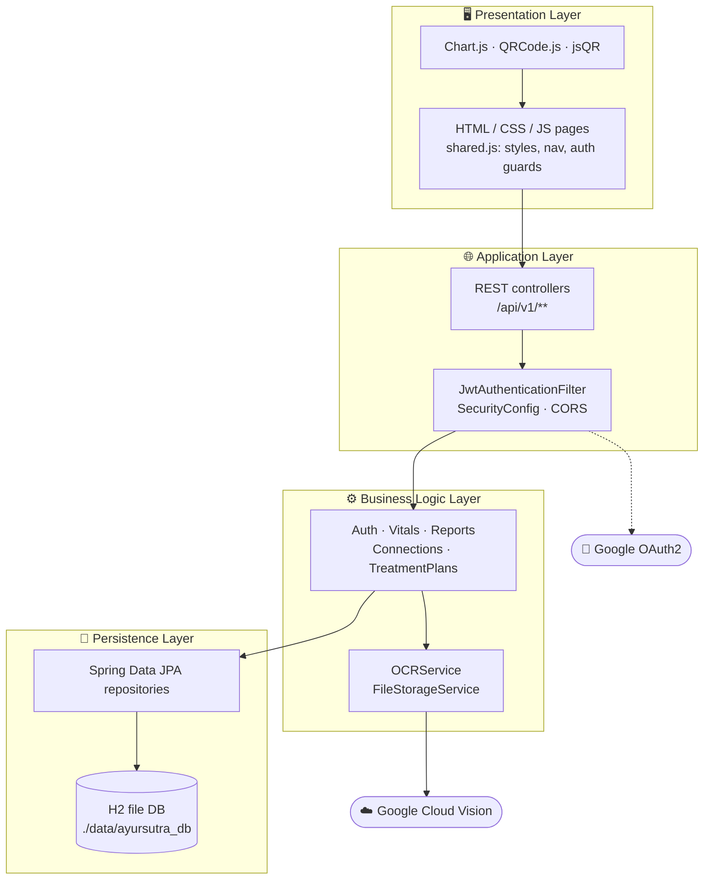
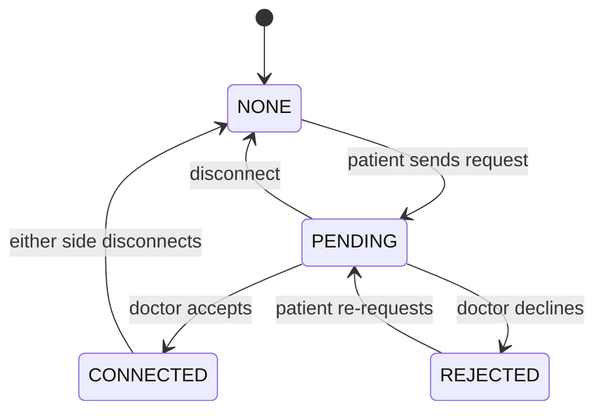
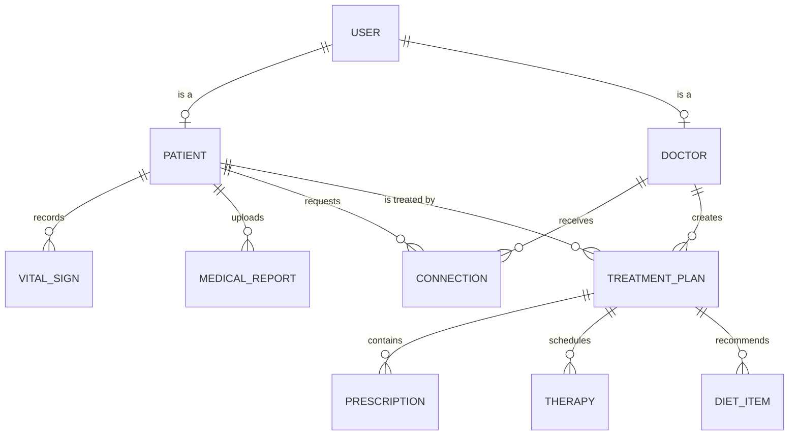

<div align="center">


# 🍃 AyurSutra

### Digital Healthcare Management for Ayurvedic Panchakarma Centres

*From paper registers to real-time health analytics, without losing the holistic touch.*

<br/>


[✨ Features](#-features) •
[🏗 Architecture](#-architecture) •
[🚀 Quick Start](#-quick-start) •
[📡 API](#-api-reference) •
[🧪 Testing](#-testing) •
[🗺 Roadmap](#-roadmap)

<br/>

[▶️ **Watch the demo**](https://www.youtube.com/watch?v=y2rQpls1S34)

</div>

---

## 📖 What is AyurSutra?

**AyurSutra** (*Ayur* = Ayurveda, *Sutra* = thread / formula) is a full-stack platform that digitises the complete **Panchakarma patient journey**: registration, vitals, medical documents, doctor connection, and personalised treatment plans with medicines, therapies and diet.

Most Panchakarma centres still run on handwritten files and manual scheduling. Generic clinic software does not understand **doshas**, multi-day therapy protocols or Ayurvedic diet logic. AyurSutra does.

<table>
<tr>
<td width="33%" valign="top">

### 😩 The problem
- Scattered paper records
- No vitals tracking during detox
- No digital doctor-patient link
- Zero analytics

</td>
<td width="33%" valign="top">

### 💡 The solution
- One secure, role-based platform
- 6-parameter vitals with trend charts
- OCR for uploaded reports
- Consent-based doctor connections

</td>
<td width="33%" valign="top">

### 🎯 The result
- Faster record retrieval
- No manual data-entry errors
- Structured treatment plans
- Instant QR patient lookup

</td>
</tr>
</table>

---

## ✨ Features

<details open>
<summary><b>👤 For Patients</b></summary>

| | Feature | Details |
|---|---|---|
| 🔐 | **Secure sign-in** | Email + password (BCrypt) or Google OAuth2, JWT sessions |
| 🪪 | **Health profile** | Dosha type, blood group, height/weight, auto-calculated BMI |
| 📱 | **Personal QR card** | Unique `AYR-PAT-XXXXXX` ID, downloadable QR code |
| ❤️ | **Vitals tracking** | BP, heart rate, temperature, weight, SpO₂, blood sugar |
| 📈 | **Trend charts** | 7 / 30 / 90 day views with normal / warning colour coding |
| 📄 | **Report upload** | PDF / JPG / PNG up to 10 MB, drag and drop |
| 🤖 | **OCR extraction** | Google Cloud Vision pulls text out of scanned reports |
| 🩺 | **Find doctors** | Search, filter, sort, and send connection requests |

</details>

<details open>
<summary><b>🩺 For Doctors</b></summary>

| | Feature | Details |
|---|---|---|
| 📬 | **Request inbox** | Accept or decline patient connection requests |
| 👥 | **Patient list** | Search by name or ID, with a slide-in clinical drawer |
| 🔍 | **Instant lookup** | Scan a patient QR with the camera or type their ID |
| 🧾 | **Treatment plans** | Diagnosis, dosha imbalance, severity, follow-up dates |
| 💊 | **Prescriptions** | Medicine, dosage, frequency, duration, timing |
| 🌿 | **Panchakarma therapies** | Abhyanga, Shirodhara, Basti, Nasya, Virechana and more, with session counters |
| 🥗 | **Diet plans** | EAT / AVOID / LIMIT items with the reason behind each |

</details>

<details>
<summary><b>🛡 Security</b></summary>

- Stateless **JWT** authentication
- **BCrypt** password hashing
- Role-based route guards (Patient / Doctor / Admin) on every protected page
- Pages blank instantly before redirect, so there is no flash of protected content
- Doctors can only create plans for patients with a `CONNECTED` relationship (enforced server-side)

</details>

---

## 🏗 Architecture

AyurSutra is a classic **4-layer N-tier** Spring Boot application. The API and the static frontend ship in a single JAR.



### 🔗 Doctor-Patient Connection State Machine



A `UNIQUE(patient_id, doctor_id)` constraint guarantees one relationship per pair.

### 🗃 Data Model



---

## 🧰 Tech Stack

| Layer | Technology |
|---|---|
| **Language** | Java 23 (works on Java 17+) |
| **Framework** | Spring Boot 3.5.9, Spring MVC, Spring Security 6.5 |
| **Persistence** | Spring Data JPA, Hibernate 6.6, H2 2.3 (file-based) |
| **Auth** | JJWT 0.13, BCrypt, Google OAuth2 client |
| **AI / OCR** | Google Cloud Vision `DOCUMENT_TEXT_DETECTION` |
| **Frontend** | Vanilla HTML5 / CSS3 / ES2020, custom `shared.js` design system |
| **Charts & QR** | Chart.js 4.4, QRCode.js, jsQR |
| **Utilities** | Lombok, Jakarta Validation |

---

## 📂 Project Structure

```text
panchkarma-management/
├── src/main/java/com/ayursutra/panchkarma/
│   ├── config/          # SecurityConfig, JwtAuthenticationFilter, OAuth2LoginSuccessHandler
│   ├── controller/      # Auth, Patient, Vital, Report, Connection, TreatmentPlan
│   ├── service/         # Business logic, OCRService, FileStorageService
│   ├── repository/      # Spring Data JPA interfaces
│   ├── entity/          # User, Patient, Doctor, VitalSign, MedicalReport,
│   │                    # Connection, TreatmentPlan, Prescription, Therapy, DietItem
│   └── dto/             # ApiResponse, request / response objects
├── src/main/resources/
│   ├── static/          # login · register · profile · health-dashboard
│   │                    # find-doctors · my-patients · doctor-dashboard
│   │                    # scan-patient · treatment-plans · shared.js
│   └── application.properties
├── data/                # H2 database files (git-ignored)
├── uploads/reports/     # Uploaded documents (git-ignored)
└── docs/                # Logo, diagrams, report
```

---

## 🚀 Quick Start

### Prerequisites

- ☕ **JDK 17+** (developed on 23)
- 📦 **Maven 3.9+**
- 🌐 A modern browser (camera access needed for QR scanning)

### 1. Clone and run

```bash
git clone https://github.com/<your-username>/ayursutra.git
cd ayursutra
mvn spring-boot:run
```

### 2. Open the app

| URL | Purpose |
|---|---|
| http://localhost:8080/login.html | App entry point |
| http://localhost:8080/register.html | Create a Patient or Doctor account |
| http://localhost:8080/h2-console | Database console (dev only) |

> **JDBC URL:** `jdbc:h2:file:./data/ayursutra_db` · **User:** `admin` · **Password:** see `application.properties`

### 3. Try the full flow in 2 minutes

1. Register a **Doctor** and a **Patient** (use two browsers or one incognito window).
2. As the patient: **Find Doctors → Connect**, then record some **vitals** and upload a **report**.
3. As the doctor: **My Patients → Requests → Accept**.
4. Open the patient drawer, review vitals and reports, then **create a treatment plan**.
5. Back as the patient, open your **QR card**, and scan it from the doctor's **Scan QR** page.

---

## ⚙️ Configuration

Everything lives in `src/main/resources/application.properties`.

```properties
# Database (file-based, survives restarts)
spring.datasource.url=jdbc:h2:file:./data/ayursutra_db

# Uploads
file.upload-dir=uploads/reports
spring.servlet.multipart.max-file-size=10MB

# JWT
jwt.secret=${JWT_SECRET}
jwt.expiration=86400000

# Google OAuth2 (optional)
spring.security.oauth2.client.registration.google.client-id=${GOOGLE_CLIENT_ID}
spring.security.oauth2.client.registration.google.client-secret=${GOOGLE_CLIENT_SECRET}

# Google Vision OCR (optional)
google.application.credentials=src/main/resources/google-vision-key.json
```

> ⚠️ **Never commit secrets.** Use environment variables for the JWT secret and Google credentials, and keep `google-vision-key.json` out of Git.

<details>
<summary><b>🔑 Enable Google Sign-In</b></summary>

1. Go to [Google Cloud Console](https://console.cloud.google.com) → **APIs & Services → Credentials**.
2. Create an **OAuth client ID** (Web application).
3. Add this redirect URI: `http://localhost:8080/login/oauth2/code/google`
4. Export your credentials:

```bash
export GOOGLE_CLIENT_ID=your-client-id
export GOOGLE_CLIENT_SECRET=your-client-secret
```

</details>

<details>
<summary><b>🤖 Enable OCR (Google Cloud Vision)</b></summary>

1. In a Google Cloud project, enable the **Cloud Vision API**.
2. Create a **Service Account** and download its JSON key.
3. Save it as `src/main/resources/google-vision-key.json`.
4. Restart. The log should show `OCR: Google Vision credentials loaded`.

No key? No problem. Uploads still succeed, and OCR is simply skipped.

</details>

---

## 📡 API Reference

All endpoints live under `/api/v1` and return a common envelope:

```json
{ "success": true, "message": "Vitals recorded successfully", "data": { } }
```

Protected routes need the header `Authorization: Bearer <jwt>`.

<details>
<summary><b>🔐 Auth and Patients</b></summary>

| Method | Endpoint | Description |
|---|---|---|
| `POST` | `/auth/login` | Email + password login, returns JWT |
| `POST` | `/patients/register` | Register a patient |
| `POST` | `/doctors/register` | Register a doctor |
| `GET` | `/patients/{id}` | Basic patient info |
| `GET` | `/patients/profile/{id}` | Full patient profile |
| `GET` | `/patients/qr/{qrCode}` | Look up a patient by QR code |
| `PUT` | `/patients/{id}/update` | Edit profile |

</details>

<details>
<summary><b>❤️ Vitals</b></summary>

| Method | Endpoint | Description |
|---|---|---|
| `POST` | `/vitals/{patientId}` | Record vitals |
| `GET` | `/vitals/{patientId}` | All readings, newest first |
| `GET` | `/vitals/{patientId}/latest` | Most recent reading |
| `GET` | `/vitals/{patientId}/range?startDate&endDate` | Date-range filter |
| `DELETE` | `/vitals/{vitalId}` | Delete a reading |

</details>

<details>
<summary><b>📄 Reports</b></summary>

| Method | Endpoint | Description |
|---|---|---|
| `GET` | `/reports/{patientId}` | List a patient's reports |
| `GET` | `/reports/detail/{reportId}` | Single report |
| `POST` | `/reports/{patientId}/upload` | Upload (multipart) |
| `POST` | `/reports/{patientId}/upload-with-ocr` | Upload and extract text |
| `DELETE` | `/reports/{reportId}` | Delete a report |

</details>

<details>
<summary><b>🔗 Connections</b></summary>

| Method | Endpoint | Description |
|---|---|---|
| `POST` | `/connections/request` | Patient → doctor request |
| `PUT` | `/connections/{id}/accept` | Doctor accepts |
| `PUT` | `/connections/{id}/reject` | Doctor declines |
| `GET` | `/connections/patient/{patientId}` | A patient's connections |
| `GET` | `/connections/doctor/{doctorId}` | A doctor's connections |
| `GET` | `/connections/doctor/{doctorId}/pending` | Pending requests |
| `GET` | `/connections/status?patientId&doctorId` | Status for one pair |
| `DELETE` | `/connections/{id}` | Disconnect |

</details>

<details>
<summary><b>💊 Treatment Plans</b></summary>

| Method | Endpoint | Description |
|---|---|---|
| `POST` | `/treatment-plans/doctor/{doctorId}/patient/{patientId}` | Create a plan |
| `GET` | `/treatment-plans/patient/{patientId}` | A patient's plans |
| `GET` | `/treatment-plans/doctor/{doctorId}` | A doctor's plans |
| `GET` | `/treatment-plans/{planId}` | Single plan |
| `PUT` | `/treatment-plans/{planId}/doctor/{doctorId}` | Update a plan |
| `PUT` | `/treatment-plans/{planId}/therapy/{therapyId}/complete-session` | Mark a session done |
| `DELETE` | `/treatment-plans/{planId}/doctor/{doctorId}` | Delete a plan |

</details>

---

## 🧪 Testing

Testing so far has been **manual and end-to-end**. These flows were verified:

- [x] Registration persists across server restarts
- [x] Email login and Google OAuth login
- [x] Vitals save, then grid and chart refresh
- [x] Report upload with and without OCR
- [x] Connection request → accept → access
- [x] Treatment plan creation (prescriptions, therapies, diet)
- [x] QR generation and camera scanning
- [x] Auth guards redirect with no content flash

---

## 🛠 Troubleshooting

<details>
<summary><b>Wipe the database and start fresh</b></summary>

Stop the app first, then delete the `data` folder.

**Windows (CMD)**
```bat
rmdir /s /q data
```

**macOS / Linux**
```bash
rm -rf data
```

Hibernate recreates every table on the next start.

</details>

<details>
<summary><b>Startup fails with <code>NULL not allowed for column</code></b></summary>

An old table already has rows that don't satisfy a newer `NOT NULL` column. Wipe the database (above) or keep the column nullable.

</details>

<details>
<summary><b>Startup fails with <code>Could not resolve attribute 'patientId'</code></b></summary>

Spring Data cannot find a field called `patientId` because the entity holds a `patient` relationship. Use underscore traversal in repository method names: `findByPatient_Id...`.

</details>

<details>
<summary><b>Pages look unstyled or redirect unexpectedly</b></summary>

Clear stale session data in the browser console, then reload:

```js
localStorage.clear();
```

</details>

<details>
<summary><b>Camera does not start on the QR scanner</b></summary>

Browsers only allow camera access on `localhost` or HTTPS. Use `http://localhost:8080` and allow the permission prompt.

</details>

---

## 🧠 Engineering Notes

A few non-obvious problems we solved along the way:

| Problem | Fix |
|---|---|
| `@CreatedDate` was `null` in the same-request response | Set the timestamp manually before `save()`, then `flush()` |
| `findByPatientId` crashed at startup | Use `findByPatient_Id...` underscore traversal |
| OCR never found credentials | Bridge the Spring property into the `GOOGLE_APPLICATION_CREDENTIALS` JVM property in `@PostConstruct` |
| Google login left the token in the URL | `login.html` reads the params, stores them, then cleans the URL |
| Protected pages flashed before redirecting | Blank the document, then `window.location.replace()` |
| H2 migration rejected a new `NOT NULL` column | Keep the column nullable, validate in the controller |


## 👥 Team

<table>
<tr>
<td align="center"><b>Tanishq Dubey</b><br/><sub>B.Tech CSE · 0818CS231203</sub></td>
<td align="center"><b>Shrishti Bagherwal</b><br/><sub>B.Tech CSE · 0818CS231184</sub></td>
<td align="center"><b>Mr. Mayur Jagdale</b><br/><sub>Project Guide · Asst. Professor</sub></td>
</tr>
</table>

Built at **Indore Institute of Science & Technology**, Indore, affiliated to **RGPV Bhopal**.

---

## 📜 License

MIT

<div align="center">

<br/>

**🍃 Made with care for traditional medicine and modern engineering 🍃**

*If this project helped you, consider leaving a ⭐*

</div>
